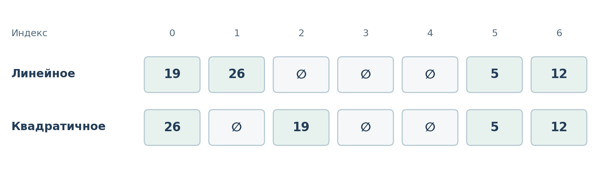
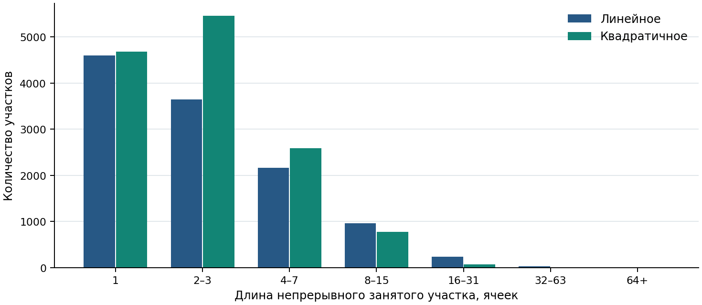
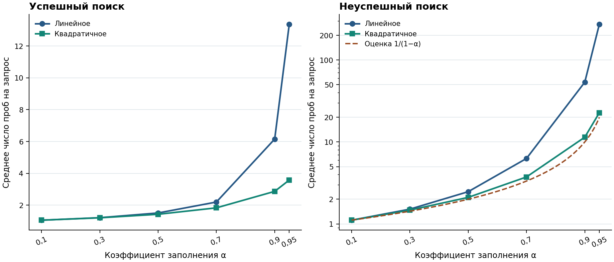

# Лабораторная работа № 5. Хеширование и экспериментальное исследование методов разрешения коллизий

**Вариант 4**  
**Дисциплина** — Основы алгоритмизации и программирование  
**Выполнила** — Булова Екатерина, группа БИ 2-1  
**Направление** — 38.03.05 «Бизнес-информатика», 2 курс

[Скачать отчёт с титульным листом и полным листингом (PDF)](report.pdf)

## Запуск

Требуется Python 3.10 или новее. Из каталога проекта выполните команды.

```bash
python -m pip install -r requirements.txt
python main.py --check
python main.py
```

Полный запуск включает сравнение с хеш-функцией по модулю 10 на 40 000 ключах. Быстрая проверка выполняется отдельно командой `python main.py --check`.

Таблицы ниже фиксируют выполненный запуск. Команда `python main.py` записывает новые CSV и графики. Для перестроения графиков по уже сохранённым CSV достаточно `python plots.py`.

## 1. Хеш-таблица и обработка коллизий

### Цель и задание варианта 4

Измерить, как способ разрешения коллизий и заполнение таблицы влияют на вставку и поиск. Исходные данные — 40 000 различных случайных целых ключей и 65 521 ячейка. Хеш-функция — метод деления. В задании В4 заполнение меняется от 10 до 95 %.

### Правила пробирования

Начальный адрес равен h(k) = k mod m. Проба — один просмотр ячейки, включая просмотр свободной. При линейном пробировании адрес равен (h(k) + i) mod m. При квадратичном — (h(k) + i²) mod m. В обоих случаях нумерация проб начинается с i = 0.



*Рисунок 1. Конечное размещение ключей 5, 12, 19, 26 при m = 7. Все четыре имеют начальный адрес 5. Символ ∅ обозначает пустую ячейку.*

### Поиск, вставка и удаление

Массивы keys и values используют одинаковые индексы. Поиск останавливается при совпадении ключа, при первой пустой ячейке или при исчерпании последовательности проб. Удаление ставит метку. Вставка запоминает первую метку и продолжает поиск существующего ключа, чтобы обновление значения не создало дубликат.

Для нечётного простого m квадраты i и m − i совпадают по модулю m. Поэтому один стартовый адрес даёт (m + 1)/2 различных позиций, в данном опыте 32 761. При заполнении выше половины вставка некоторых наборов ключей может завершиться ошибкой. Программа ограничивает число проб и проверяет этот случай на таблице из 7 ячеек.

[Блок-схема поиска позиции](diagrams/probing.md) · [Реализация хеш-таблицы](hash_table.py)

## 2. Результаты при 40 000 ключах

Использован Linux и CPython 3.12.14. Генератор со значением seed = 4 выбирает различные целые числа из диапазона от 1 до 2³¹ − 1. Для трёх реализаций совпадают ключи, порядок вставки и запросы. Для собственных таблиц α = 40 000 / 65 521 ≈ 0,61049. Встроенный dict сам управляет ёмкостью.

### Вставка и поиск

Время дано за серию в миллисекундах. Вставляется весь набор, затем выполняются 4 000 успешных и отдельно 4 000 неуспешных запросов. Время — медиана трёх повторов по perf_counter_ns. Генерация данных и проверка ответов вынесены из измерения.

| Реализация | Вставка, мс | Поиск +, мс | Поиск −, мс | Проб / вставку | Проб / поиск + | Проб / поиск − |
| :--- | ---: | ---: | ---: | ---: | ---: | ---: |
| Линейное | 23,12 | 1,92 | 2,42 | 1,79 | 1,77 | 3,81 |
| Квадратичное | 25,57 | 2,19 | 2,53 | 1,62 | 1,62 | 2,79 |
| Встроенный dict | 1,85 | 0,16 | 0,12 | — | — | — |

«+» означает найденный ключ, «−» — отсутствующий. Для dict интерфейс Python не раскрывает число проб. Его встроенные операции выполняются в коде интерпретатора. Учебные классы дополнительно обходят последовательность проб и ведут счётчики на Python.

### Распределение длин занятых участков

| Пробирование | Число участков | Средняя длина, ячеек | Максимум, ячеек |
| :--- | ---: | ---: | ---: |
| Линейное | 11 629 | 3,44 | 58 |
| Квадратичное | 13 585 | 2,94 | 28 |



*Рисунок 2. Максимальные непрерывные участки занятых ячеек. Начало и конец массива считаются соседними.*

Линейный метод дал самый длинный участок в 58 ячеек, квадратичный — в 28. При линейном обходе свободная ячейка после длинной серии проверяется из многих начальных адресов, поэтому такая серия чаще удлиняется.

## 3. Задание В4. Число проб и заполнение

В каждой строке n = round(65 521 × α). Из общей перестановки берётся префикс длины n. Успешные запросы выбираются из него, отсутствующие ключи выделены заранее из непересекающейся выборки. Каждая пара методов получает одинаковые данные.

| Целевое α | Ключей n | Поиск +, Л | Поиск +, К | Поиск −, Л | Поиск −, К | 1/(1 − α) |
| :--- | ---: | ---: | ---: | ---: | ---: | ---: |
| 0,10 | 6 552 | 1,06 | 1,06 | 1,11 | 1,11 | 1,11 |
| 0,30 | 19 656 | 1,22 | 1,21 | 1,51 | 1,47 | 1,43 |
| 0,50 | 32 760 | 1,51 | 1,43 | 2,47 | 2,11 | 2,00 |
| 0,70 | 45 865 | 2,20 | 1,83 | 6,28 | 3,74 | 3,33 |
| 0,90 | 58 969 | 6,16 | 2,87 | 53,63 | 11,43 | 10,00 |
| 0,95 | 62 245 | 13,37 | 3,58 | 273,53 | 22,73 | 20,00 |

Л — линейное пробирование, К — квадратичное. В последней колонке используется фактическое отношение n/m. В модели равномерных проб при неуспешном поиске вероятность продолжить поиск близка к α, а сумма 1 + α + α² + … равна 1/(1 − α).



*Рисунок 3. Слева — успешные запросы. Справа — неуспешные, шкала числа проб логарифмическая. Пунктир показывает оценку для равномерного пробирования.*

При α = 0,95 равномерная модель даёт около 20 проб. Получено 273,53 при линейном и 22,73 при квадратичном обходе. Длинные серии соседних занятых ячеек сильнее всего замедлили линейный поиск отсутствующего ключа. Все 62 245 ключей удалось вставить обоими методами.

## 4. Время операций и качество хеш-функции

### Время серий при изменении заполнения, мс

Вставка включает n операций. В каждом из двух поисковых опытов выполнено по 4 000 запросов при уже достигнутом заполнении. Столбцы Л и К относятся к тем же данным, что и в задании В4.

| α | Вставка Л | Вставка К | Поиск +, Л | Поиск +, К | Поиск −, Л | Поиск −, К |
| :--- | ---: | ---: | ---: | ---: | ---: | ---: |
| 0,10 | 3,59 | 3,76 | 1,74 | 2,00 | 1,70 | 1,93 |
| 0,30 | 11,00 | 11,64 | 1,78 | 2,00 | 1,79 | 2,06 |
| 0,50 | 18,49 | 20,61 | 1,83 | 2,15 | 2,06 | 2,31 |
| 0,70 | 29,50 | 30,16 | 2,15 | 2,28 | 3,23 | 2,87 |
| 0,90 | 58,68 | 48,41 | 3,58 | 2,81 | 16,99 | 6,53 |
| 0,95 | 78,02 | 56,62 | 4,81 | 2,98 | 71,82 | 10,63 |

### Деление по модулю m и по модулю 10

Здесь обе функции работают на одних и тех же 40 000 ключах, при m = 65 521. Число повторных начальных адресов равно n минус число различных h(k). Дополнительные пробы — число просмотров сверх одной обязательной пробы на каждую вставку.

| Хеш | Пробирование | Разных h(k) | Повторных адресов | Вставок с обходом | Дополнительных проб |
| :--- | ---: | ---: | ---: | ---: | ---: |
| k mod m | Линейное | 30 038 | 9 962 | 12 163 | 31 490 |
| k mod m | Квадратичное | 30 038 | 9 962 | 12 122 | 24 648 |
| k mod 10 | Линейное | 10 | 39 990 | 39 993 | 799 800 628 |
| k mod 10 | Квадратичное | 10 | 39 990 | 39 993 | 104 244 744 |

| Хеш | Пробирование | Проб / вставку | Проб / поиск + | Проб / поиск − |
| :--- | ---: | ---: | ---: | ---: |
| k mod m | Линейное | 1,79 | 1,88 | 4,14 |
| k mod m | Квадратичное | 1,62 | 1,64 | 2,96 |
| k mod 10 | Линейное | 19 996,02 | 21 019,92 | 39 996,62 |
| k mod 10 | Квадратичное | 2 607,12 | 2 749,73 | 5 940,15 |

Для этого сравнения из исходных запросов взяты одни и те же 256 успешных и 256 неуспешных. Число проб на вставку усредняется по всем 40 000 операциям.

### Выводы

При k mod 10 всего десять начальных адресов. Средняя вставка линейным методом потребовала 19 996,02 пробы против 1,79 при k mod m. Квадратичный обход сократил число дополнительных просмотров, но качество исходной хеш-функции по-прежнему определяло затраты.

При исходном заполнении dict выполнил 4 000 успешных запросов за 0,16 мс. Из двух собственных реализаций квадратичная экономнее по числу проб, особенно в почти заполненной таблице. Абсолютное время зависит также от стоимости вычисления следующей позиции.

## 5. Контрольные вопросы

**1. Почему прямая адресация неудобна для ИНН?** Если индекс совпадает с идентификатором, память требуется под весь диапазон номеров. При редких ключах большая часть ячеек простаивает.

**2. Что такое коллизия и почему она неизбежна?** Это совпадение h(k) у двух разных ключей. Когда возможных ключей больше, чем адресов, хотя бы два ключа отображаются в одну ячейку.

**3. Как выбрать хеш-функцию?** Она должна быть детерминированной, быстро вычисляться и хорошо распределять реальные ключи. Остаток по модулю 10 использует всего десять адресов.

**4. Почему для метода деления берут простое m?** Так реже совпадают делители размера и характерного шага ключей. Равномерность всё равно зависит от данных. Например, все кратные m дают адрес 0.

**5. Что показывает α?** Это n/m. Для цепочек α может превышать единицу. При открытой адресации физический предел равен 1, а для эффективного поиска оставляют свободные ячейки.

**6. Что происходит при α → 1?** В модели равномерного пробирования 1/(1 − α) оценивает число проб неуспешного поиска. По мере исчерпания пустых ячеек это число растёт.

**7. Что такое первичная кластеризация?** При линейном обходе соседние занятые ячейки образуют растущие серии. Квадратичные смещения и двойное хеширование уменьшают этот эффект.

**8. Почему удаление оставляет метку?** Ключ, сдвинутый коллизией, может находиться дальше по маршруту. Если поставить признак «пусто», поиск остановится до нужной ячейки.

**9. Что такое рехеширование?** Элементы переносят в новый массив и пересчитывают адреса. При геометрическом росте суммарное число переносов линейно, поэтому средняя амортизированная стоимость вставки остаётся O(1) при хорошем распределении.

**10. Как выполнять диапазонные запросы?** Хеш-поиск эффективен по точному ключу. Для интервалов и упорядоченного обхода подходят сбалансированное дерево поиска или отсортированный массив. Порядок вставки у dict отличается от сортировки по ключу.

### Источники

- Лабораторная работа № 5. Хеширование и экспериментальное исследование методов разрешения коллизий. Методические указания, таблицы 1 и 2.
- [OpenDSA. Improved Collision Resolution](https://opendsa-server.cs.vt.edu/ODSA/Books/vt/cs3114/fall-2025/F25OpendSA/html/HashCImproved.html)
- [Python 3.12. Словари dict](https://docs.python.org/3.12/library/stdtypes.html#mapping-types-dict)

## Листинг программы и протоколы

| Файл | Содержание |
| :--- | :--- |
| [hash_table.py](hash_table.py) | хеш-таблица и обход кластеров |
| [main.py](main.py) | измерения, контрольные примеры и сравнение с dict |
| [plots.py](plots.py) | построение графиков |
| [results/baseline.csv](results/baseline.csv) | основной эксперимент |
| [results/load.csv](results/load.csv) | все шесть заполнений |
| [results/hashes.csv](results/hashes.csv) | сравнение хеш-функций |
| [results/clusters.csv](results/clusters.csv) | точное распределение длин серий |
| [results/run.json](results/run.json) | параметры запуска |
