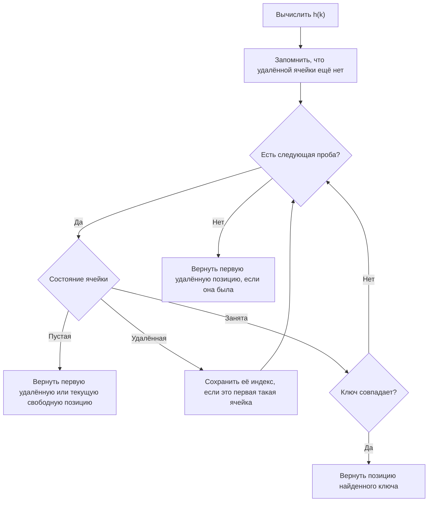

# Поиск позиции в таблице с открытой адресацией

Для линейного метода смещение равно i. Для квадратичного метода смещение равно i².
Каждый осмотр ячейки увеличивает число проб на единицу. Вставка обновляет
найденный ключ или занимает свободную позицию. Если доступные позиции исчерпаны,
вставка сообщает об ошибке. Поиск и удаление используют тот же маршрут.
